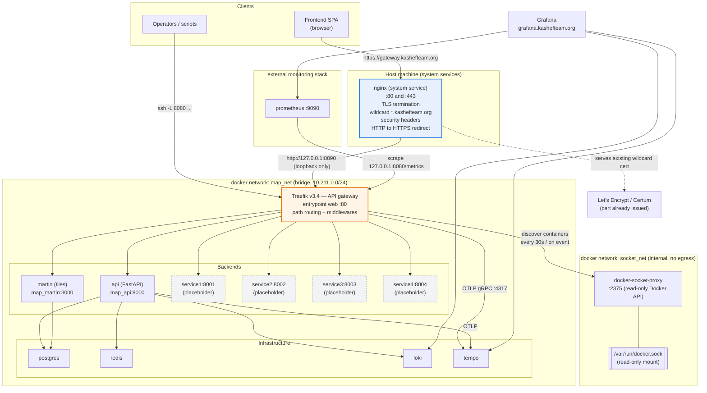
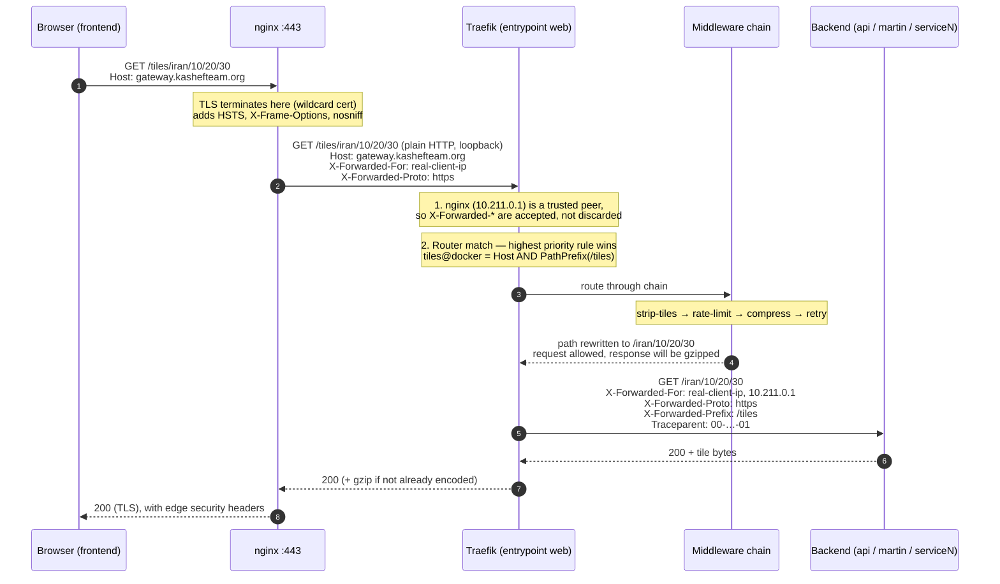
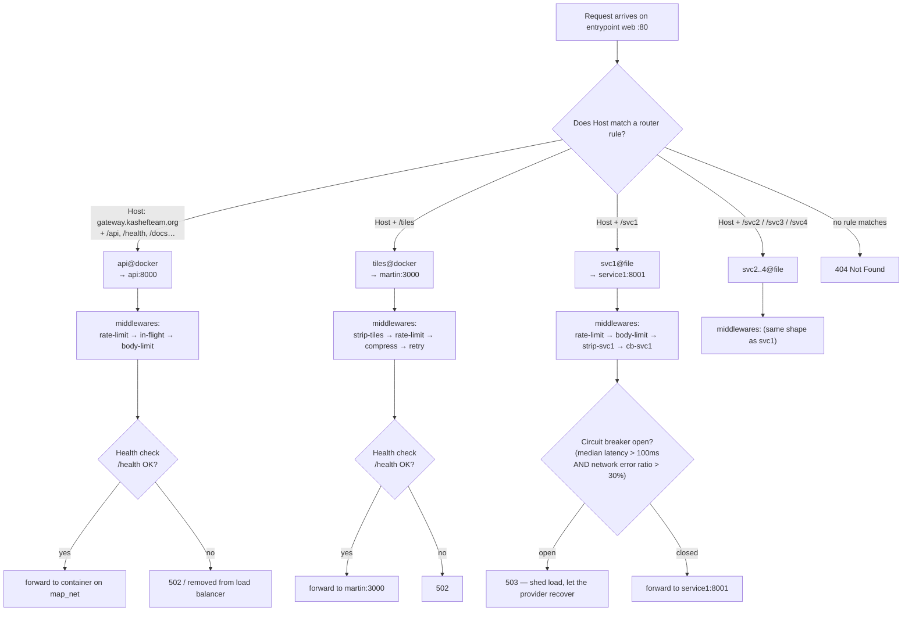
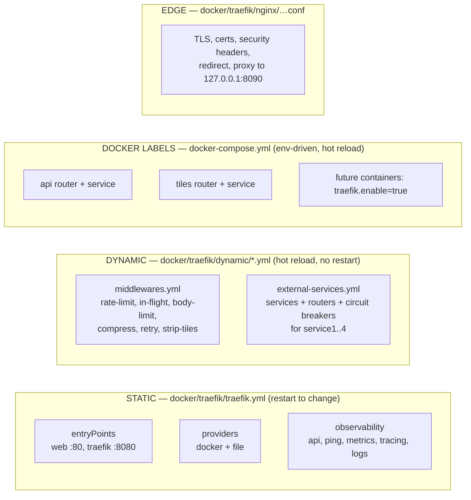
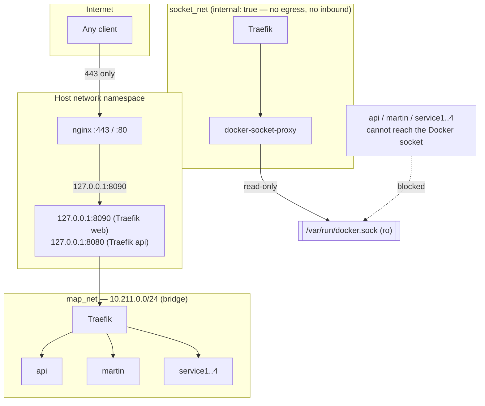
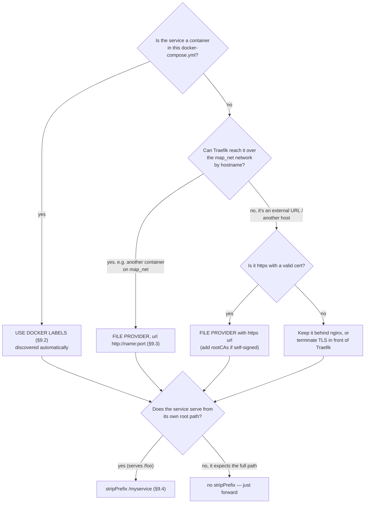
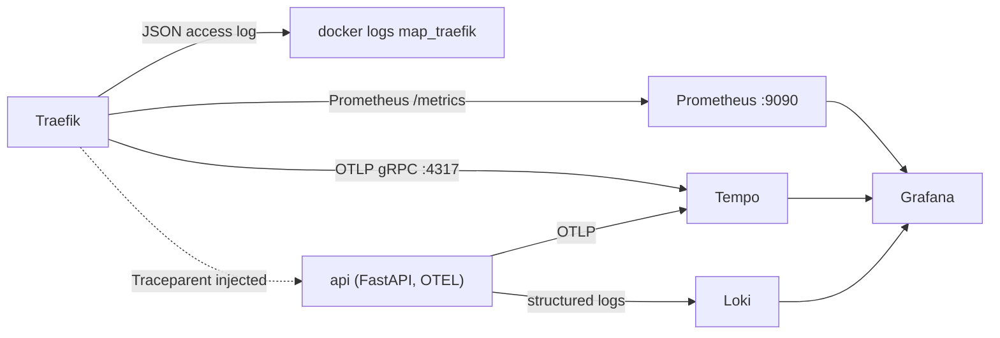

# API Gateway — Design Document

Traefik-based API gateway for the Map Platform (`nazer-backend`).

The goal: **the frontend talks to exactly one origin** —
`https://gateway.kashefteam.org` — and never learns the address of any
backend service. Adding, moving or rewriting a backend is a gateway
configuration change, not a frontend change.

> **Viewing the diagrams.** Every diagram below is valid [Mermaid](https://mermaid.js.org)
> and renders natively on GitHub and in VS Code (with the *Markdown Preview Mermaid
> Support* extension). Plain markdown viewers and terminals show the source code
> instead of a picture — if that is what you see, open **`design-diagrams.html`**
> in a browser to view all seven diagrams rendered.

---

## Table of contents

1. [Constraints discovered on this host](#1-constraints-discovered-on-this-host)
2. [Architecture](#2-architecture)
3. [How a request flows](#3-how-a-request-flows)
4. [Routing table](#4-routing-table)
5. [How Traefik picks a router](#5-how-traefik-picks-a-router)
6. [Configuration model — where to put what](#6-configuration-model--where-to-put-what)
7. [Networks and security model](#7-networks-and-security-model)
8. [Middleware reference](#8-middleware-reference)
9. [How to route a new service](#9-how-to-route-a-new-service)
10. [Observability](#10-observability)
11. [Operations runbook](#11-operations-runbook)
12. [Promoting Traefik to the TLS edge](#12-promoting-traefik-to-the-tls-edge)
13. [Known limitations](#13-known-limitations)
14. [Verified behaviour](#14-verified-behaviour)

---

## 1. Constraints discovered on this host

These facts drove the whole design and are worth knowing before changing it.

| # | Finding | Consequence |
|---|---------|-------------|
| 1 | A **host-level nginx** (system service, not a container) already owns `:80` and `:443` and reverse-proxies ~15 other projects | Traefik must **not** try to bind 80/443. It listens on loopback and nginx fronts it. |
| 2 | The server holds a **wildcard certificate** `*.kashefteam.org` (`/etc/ssl/kashefteamcerts/`) | `gateway.kashefteam.org` is **already covered**. No ACME, no certbot run, no rate-limit risk. |
| 3 | `127.0.0.1:8080` is already occupied on this machine | The dashboard/metrics port is parameterised (`TRAEFIK_API_PORT`). It currently runs on **8091**. |
| 4 | The Compose project is named `nazer-backend` (not the directory name) | Network names would become `nazer-backend_map_net`. Hence the explicit `name: map_net`, which the static config references literally. |
| 5 | Traefik does **not** expand `${VARS}` in `traefik.yml`, and when `--configFile` is used it ignores env vars/CLI flags entirely | Environment-specific values (the domain) live in **Docker labels** in `docker-compose.yml`, where Compose expands them. Dynamic files use literals. |
| 6 | `map_api`, `map_martin`, `map_postgres`… were running on the old default network | They must be redeployed onto `map_net` before the gateway can reach them. |

> The nginx server block is installed at
> `/etc/nginx/sites-available/gateway.kashefteam.org` (symlinked into
> `sites-enabled`), validated with `nginx -t` and loaded with a graceful
> reload — the other sites on the box were not touched.

---

## 2. Architecture



**Reading the diagram.** Everything the frontend can reach passes through
one door: `nginx :443` → `Traefik :8090` → a backend. Traefik also has a
second, private door (`:8080`) used only by operators and Prometheus.
Nothing else is published to the internet.

---

## 3. How a request flows



Key behaviours this encodes:

- **TLS is terminated once**, at nginx. Traefik speaks plain HTTP internally.
- **`Host` is preserved end to end**, which is what makes Traefik's
  `Host(...)` rules work and prevents cross-domain routing.
- **The real client IP survives** because nginx is declared a trusted peer
  (`forwardedHeaders.trustedIPs: 10.211.0.1`). Without that, Traefik would
  discard `X-Forwarded-For` and rate-limit all clients as one.
- **`X-Forwarded-Proto: https`** is preserved, so the FastAPI app generates
  correct URLs and secure cookies even though it only ever sees HTTP.
- **`Traceparent`** is injected by Traefik, so the gateway span and the app
  span join into one trace in Tempo.

---

## 4. Routing table

All public routes share the entrypoint `web` (:80) and the host
`gateway.kashefteam.org`.

| # | Path on the gateway | Router | Backend actually called | Prefix stripped? | Middlewares (in order) |
|---|---|---|---|---|---|
| 1 | `/api/*` | `api@docker` | `api:8000` (FastAPI) | no — `/api/v1/x` stays `/api/v1/x` | `rate-limit` → `in-flight` → `body-limit` |
| 2 | `/health` | `api@docker` | `api:8000` | no | same as above |
| 3 | `/docs`, `/redoc`, `/openapi.json` | `api@docker` | `api:8000` | no | same as above |
| 4 | `/tiles/*` | `tiles@docker` | `martin:3000` | **yes** → `/iran/10/20/30` | `strip-tiles` → `rate-limit` → `compress` → `retry` |
| 5 | `/svc1/*` | `svc1@file` | `service1:8001` | **yes** → `/orders/42` | `rate-limit` → `body-limit` → `strip-svc1` → `cb-svc1` |
| 6 | `/svc2/*` | `svc2@file` | `service2:8002` | **yes** | `rate-limit` → `body-limit` → `strip-svc2` → `cb-svc2` |
| 7 | `/svc3/*` | `svc3@file` | `service3:8003` | **yes** | `rate-limit` → `body-limit` → `strip-svc3` → `cb-svc3` |
| 8 | `/svc4/*` | `svc4@file` | `service4:8004` | **yes** | `rate-limit` → `body-limit` → `strip-svc4` → `cb-svc4` |
| 9 | anything else | — | — | — | **404** (by design) |

Private area, reachable only on the loopback port `:8080`:

| Path | Purpose |
|---|---|
| `:8080/dashboard/` | Traefik dashboard |
| `:8080/api/…` | Traefik's own REST API (routers, services, rawdata) |
| `:8080/metrics` | Prometheus metrics |
| `:8080/ping` | Liveness probe (also used by the container healthcheck) |

> **Why the API path is *not* stripped:** FastAPI already mounts its routes
> under `/api/v1` (`API_V1_PREFIX`). The gateway forwards the path unchanged,
> so no `root_path`/prefix juggling is needed in the app.
> Tile and microservice prefixes *are* stripped, so those services keep
> serving from their own root exactly as they do today.

---

## 5. How Traefik picks a router



Rules of thumb that fall out of this:

- A rule **must** include `Host(...)`. Path-only rules would answer for any
  domain pointed at the server.
- When two routers could match, Traefik compares **rule length** (roughly,
  specificity) and the longer rule wins. Give intentionally broad routes a
  lower priority, or just make the path prefixes disjoint as they are here.

---

## 6. Configuration model — where to put what

Traefik splits configuration into **static** (read once) and **dynamic**
(hot-reloaded). Mixing them up is the most common source of confusion.



| File | Loaded | Change requires | Holds |
|---|---|---|---|
| `docker/traefik/traefik.yml` | once, at startup | `docker restart map_traefik` | entrypoints, providers, trusted IPs, metrics, tracing |
| `docker/traefik/dynamic/middlewares.yml` | watched | nothing — reloads automatically | shared middlewares |
| `docker/traefik/dynamic/external-services.yml` | watched | nothing — reloads automatically | services/routers for non-container backends |
| `docker-compose.yml` (labels) | watched via Docker API | `docker compose up -d` | routers/services for containers in this project |
| `docker/traefik/nginx/gateway.kashefteam.org.conf` | at nginx reload | `nginx -t && systemctl reload nginx` | TLS, edge headers, upstream to Traefik |

**The one rule to remember:** values that differ per environment must be in
Docker labels (Compose expands `${DOMAIN}`), because neither `traefik.yml`
nor the dynamic files expand variables.

---

## 7. Networks and security model



Design decisions worth calling out:

- **The Docker socket is never mounted into Traefik.** Traefik talks to
  `docker-socket-proxy`, which exposes only `CONTAINERS`, `SERVICES`,
  `TASKS`, `NETWORKS`, `VERSION`, `EVENTS`, `PING` — all read-only. A
  compromise of the gateway cannot start, exec into or delete containers.
- **The proxy lives on its own internal network** (`socket_net`,
  `internal: true`). Application containers on `map_net` cannot reach the
  Docker API at all.
- **Only loopback ports are published** for Traefik; `api` and `martin` are
  published on `127.0.0.1` purely for local debugging. The public surface is
  nginx and nothing else.
- **`exposedByDefault: false`** — a new container is invisible to the
  gateway until it explicitly says `traefik.enable=true`.
- **Fixed subnet `10.211.0.0/24`**, deliberately outside Docker's default
  `172.17–172.31` pool, so the trusted-peer IP (`10.211.0.1`) is stable and
  cannot collide with another network on this busy host.

---

## 8. Middleware reference

Defined in `dynamic/middlewares.yml` (and `external-services.yml` for the
per-service circuit breakers). Reference them from a label or a dynamic
router with the `@file` suffix, e.g. `rate-limit@file`. **Order in the list
is the order of execution.**

| Middleware | Type | Settings | Attached to |
|---|---|---|---|
| `rate-limit` | `rateLimit` | 100 req/s sustained, burst 50, keyed on real client IP | api, tiles, svc1..4 |
| `in-flight` | `inFlightReq` | max 200 concurrent requests per client | api |
| `body-limit` | `buffering` | request ≤ 10 MiB, 2 MiB in memory then spill to disk; responses unlimited | api, svc1..4 |
| `compress` | `compress` | gzip/brotli/zstd, skips already-encoded responses | tiles |
| `retry` | `retry` | 3 attempts, 100 ms apart | tiles (**read-only GETs only**) |
| `strip-tiles` | `stripPrefix` | removes `/tiles` | tiles |
| `strip-svcN` | `stripPrefix` | removes `/svcN` | svc1..4 |
| `cb-svcN` | `circuitBreaker` | open when median latency > 100 ms **and** network error ratio > 30 %; check 10 s, fallback 10 s, recovery 30 s | svc1..4 |
| `security-headers` | `headers` | HSTS, XFO, nosniff, referrer, permissions-policy | **defined but deliberately NOT attached** — nginx emits them (see below) |

Two deliberate omissions:

- **No `compress` on the API router** — the FastAPI app already applies
  `GZipMiddleware`. Traefik only compresses backends that don't.
- **No security headers on any Traefik router** — nginx is the TLS edge and
  already emits HSTS / X-Frame-Options / X-Content-Type-Options. Setting
  them in both places produces *duplicate* headers, which browsers can
  reject. If Traefik ever becomes the edge, uncomment the block in
  `middlewares.yml` and drop the `add_header` lines from the nginx server
  block.

> **Circuit breaker gotcha (learned the hard way).** Do not build the
> expression around `ResponseCodeRatio()` alone, e.g.
> `NetworkErrorRatio() > 0.30 || ResponseCodeRatio(500,600,0,600) > 0.30`.
> It trips after a single 5xx and then **never closes**, because the
> breaker's own 503 replies keep the ratio above the threshold. The config
> uses Traefik's documented default, `LatencyAtQuantileMS(50.0) > 100 &&
> NetworkErrorRatio() > 0.30`, which provably recovers.

---

## 9. How to route a new service

### 9.1 Decide first



### 9.2 Recipe A — container in this Compose project (**preferred**)

Add labels to the service. Nothing else is required: Traefik discovers
containers on `map_net` through the socket proxy, on startup and on every
Docker event.

```yaml
  reports:
    image: myorg/reports:1.4
    container_name: map_reports
    restart: unless-stopped
    networks:
      - map_net                # REQUIRED — the gateway only sees map_net
    expose:
      - "9000"                 # internal only; do NOT publish a public port
    labels:
      traefik.enable: "true"                        # opt-in; default is false
      traefik.docker.network: "map_net"             # which IP to dial

      # ── Router ────────────────────────────────────────────────────
      # `${DOMAIN:-…}` is expanded by Compose, so the domain stays in .env
      traefik.http.routers.reports.rule: "Host(`${DOMAIN:-gateway.kashefteam.org}`) && PathPrefix(`/reports`)"
      traefik.http.routers.reports.entrypoints: "web"
      traefik.http.routers.reports.middlewares: "strip-reports@file,rate-limit@file,in-flight@file,body-limit@file"

      # ── Service (the container itself) ────────────────────────────
      traefik.http.services.reports.loadbalancer.server.port: "9000"   # port INSIDE the container
      traefik.http.services.reports.loadbalancer.healthcheck.path: "/health"
      traefik.http.services.reports.loadbalancer.healthcheck.interval: "15s"
      traefik.http.services.reports.loadbalancer.healthcheck.timeout: "5s"
```

…and add the matching strip middleware to `dynamic/middlewares.yml`:

```yaml
    strip-reports:
      stripPrefix:
        prefixes:
          - "/reports"
```

Then:

```bash
docker compose up -d reports     # Traefik picks it up within seconds
curl -s https://gateway.kashefteam.org/reports/health
```

Notes:

- The `@file` suffix is **mandatory** when a Docker label references a
  middleware defined in `dynamic/`.
- `loadbalancer.server.port` is the **container** port, not a host port.
- Set a `healthcheck.path` that the service actually answers; unhealthy
  backends are removed from the load balancer automatically.
- Do not publish a host port for a service that is only meant to be reached
  through the gateway.

### 9.3 Recipe B — service that is not a container (external URL)

Edit `docker/traefik/dynamic/external-services.yml`. It hot-reloads, so no
restart. This is the pattern `svc1..4` already follow.

```yaml
http:
  services:
    payments:
      loadBalancer:
        servers:
          - url: "https://payments.internal.example.com"   # or http://host:port
        passHostHeader: false        # backend doesn't care about the original Host
        serversTransport: external   # reuse the shared timeout profile

  middlewares:
    strip-payments:
      stripPrefix:
        prefixes: ["/payments"]

  routers:
    payments:
      # The host MUST be written literally here — dynamic files do not
      # expand ${VARS}. Keep it in sync with DOMAIN in .env.
      rule: "Host(`gateway.kashefteam.org`) && PathPrefix(`/payments`)"
      entryPoints:
        - web
      service: payments@file
      middlewares:
        - rate-limit@file
        - body-limit@file
        - strip-payments@file
        - cb-payments@file     # optional, see below
```

Verify without restarting anything:

```bash
# list the routers Traefik actually built, and any config errors
curl -s http://127.0.0.1:8080/api/http/routers | python3 -m json.tool | less
# what Traefik thinks the backend URL is
curl -s http://127.0.0.1:8080/api/http/services | python3 -m json.tool | less
```

### 9.4 Stripping, or not

| Backend behaviour | Middleware |
|---|---|
| Serves from its own root (`GET /orders/42`) | `stripPrefix: ["/svc1"]` — so the backend never learns about the gateway prefix |
| Expects the gateway path (`GET /api/v1/orders`) | **no** strip — FastAPI's `API_V1_PREFIX` already matches |
| Needs to know it was rewritten | Traefik also sets `X-Forwarded-Prefix` (observable in the tests below) |

### 9.5 Choosing the public shape

| You want | Rule | Example |
|---|---|---|
| Several services on **one** origin, split by path | `Host(...) && PathPrefix('/x')` | `…/api`, `…/tiles`, `…/svc1` — what is implemented |
| A service with its **own** subdomain | add an nginx server block + a router on that host | `reports.kashefteam.org` |
| A service with its own **port** | avoid it — that reintroduces the multi-origin problem the gateway exists to remove | — |

For a second subdomain you need three things: the DNS record, the wildcard
cert already covers it, and a new nginx server block whose `proxy_pass`
points at the same `127.0.0.1:8090`. Traefik then routes on the new `Host`.

### 9.6 Migrating the existing `svc1..4` placeholders

When those services start running as containers, the cleanest end state is:

1. add Recipe-A labels to each service in `docker-compose.yml`;
2. delete its `services` / `routers` / `cb-svcN` / `strip-svcN` blocks from
   `dynamic/external-services.yml`.

That way the domain comes from `${DOMAIN}` in one place and discovery is
automatic.

---

## 10. Observability



| Signal | Where it comes from | Where to look |
|---|---|---|
| Access logs | `accessLog.format: json` on every request | `docker logs map_traefik` |
| Traefik metrics | `metrics.prometheus`, labelled by entrypoint/router/service | Prometheus scrapes `127.0.0.1:8080/metrics` |
| Traces | `tracing.otlp` → `tempo:4317`, W3C `tracecontext` propagation | Grafana → Tempo; a request is one trace from gateway to app |
| Router/service state | Traefik API (loopback only) | `:8080/api/http/routers`, `…/services`, `…/rawdata` |

Because Traefik injects `Traceparent` and the app is already OTel-instrumented
(`OTEL_PROPAGATORS: tracecontext,baggage`), a single frontend request becomes
one end-to-end trace — the gateway's span sits above the app's spans.

---

## 11. Operations runbook

### First-time deploy

```bash
# 1. DNS — point the host at this server
#    gateway.kashefteam.org   A   31.7.70.193

# 2. Environment
cp .env.example .env
#    DOMAIN=gateway.kashefteam.org
#    TRAEFIK_HTTP_PORT=8090     # nginx proxies here
#    TRAEFIK_API_PORT=8091      # NOTE: 8080 is already taken on this host

# 3. Bring up the gateway (and the rest of the stack so it joins map_net)
docker compose up -d

# 4. nginx front door (already done on this host)
sudo nginx -t && sudo systemctl reload nginx
```

### Verify

```bash
curl -s https://gateway.kashefteam.org/health                # {"status":"ok",...}
curl -s https://gateway.kashefteam.org/openapi.json | head   # FastAPI schema
curl -s -o /dev/null -w '%{http_code}\n' \
     https://gateway.kashefteam.org/tiles/catalog            # 200
curl -s -o /dev/null -w '%{http_code}\n' \
     https://gateway.kashefteam.org/svc1/ping                # 502 until service1 runs

# internal view (loopback only)
curl -s http://127.0.0.1:8080/api/http/routers | python3 -m json.tool
curl -s http://127.0.0.1:8080/ping
```

Dashboard over an SSH tunnel (it is bound to loopback and not public):

```bash
ssh -L 8080:127.0.0.1:8080 <server>
# then open http://localhost:8080/dashboard/
```

### Troubleshooting

| Symptom | Likely cause | Fix |
|---|---|---|
| `404` from Traefik on a valid path | no router matched — wrong host, or the container is not on `map_net` | check `traefik.enable=true`, `traefik.docker.network=map_net`, `docker compose config` |
| `502` | router exists but the backend is unreachable or unhealthy | `docker compose ps`; check the service's `healthcheck.path` |
| `503` on an `/svcN` route | circuit breaker open (provider failing) | fix the provider; it closes on its own after fallback + recovery |
| Traefik can't start, "address already in use" on 8080 | something else owns `8080` | set `TRAEFIK_API_PORT` to a free port |
| Rate limit feels global, not per client | nginx is not the trusted peer | make sure the request comes via nginx (`10.211.0.1`), see `forwardedHeaders.trustedIPs` |
| Edits to `dynamic/*.yml` not applied | file provider failed to load the YAML | check `docker logs map_traefik` for a parse error |
| `Could not close the tracer` in logs | Tempo unreachable from Traefik | expected until the whole stack is redeployed onto `map_net` |

Handy one-liners:

```bash
docker logs --tail 50 map_traefik | grep -i error
docker compose config | grep -A2 traefik.http.routers      # see resolved rules
docker network inspect map_net                             # who is attached
```

---

## 12. Promoting Traefik to the TLS edge

Only worth doing if nginx is ever retired. Steps:

1. **Static config** — add a redirecting `web` and a TLS `websecure`
   entrypoint plus a resolver to `traefik.yml`:

   ```yaml
   entryPoints:
     web:
       address: ":80"
       http:
         redirections:
           entryPoint: { to: websecure, scheme: https, permanent: true }
     websecure:
       address: ":443"
   certificatesResolvers:
     letsencrypt:
       acme:
         storage: /letsencrypt/acme.json
         httpChallenge: { entryPoint: web }
   ```

2. **Compose** — publish `80:80` / `443:443` instead of the loopback mapping,
   mount a `traefik_letsencrypt` volume, and remove `forwardedHeaders.trustedIPs`
   (or repoint it at the new upstream).

3. **Routers** — move Docker labels and `external-services.yml` from the
   `web` entrypoint to `websecure`, and add:

   ```yaml
   traefik.http.routers.api.tls: "true"
   traefik.http.routers.api.tls.certresolver: "letsencrypt"
   ```

4. **Security headers** — enable the `security-headers` middleware in
   `middlewares.yml` and delete the `add_header` lines from the nginx block.

5. **nginx** — stop publishing 80/443, or repoint each remaining site.

---

## 13. Known limitations

- **`/svc1..4` answer `502`** until those microservices exist on `map_net`.
  The routes are intentionally live placeholders.
- **The domain appears in two places** — `${DOMAIN}` in Compose labels and a
  literal `Host(...)` in `dynamic/external-services.yml` — because Traefik
  does not expand variables in dynamic config. Keep them in sync, or move
  those routes to Docker labels once the services are containers.
- **The gateway is behind nginx**, so nginx `proxy_read_timeout: 300s` is the
  real ceiling for long-running requests, not Traefik's.
- **TLS is not end-to-end**: nginx → Traefik is plain HTTP over loopback.
  Acceptable on a single host; it would need TLS if Traefik were moved off-box.
- **The running stack must be redeployed** (`docker compose up -d`) before
  the gateway can reach the real `api`/`martin` — they still sit on the old
  `nazer-backend_default` network.
- **`TRAEFIK_API_PORT` defaults to 8080**, which is already occupied on this
  machine; set it to `8091` (or free 8080).

---

## 14. Verified behaviour

Everything below was exercised against the running stack, not assumed.

| Check | Method | Result |
|---|---|---|
| Static + dynamic config loads | `GET :8080/api/rawdata` | **0 config errors** |
| Compose rendering | `docker compose config` | exit 0, no warnings |
| Full chain | `curl --resolve …:443:127.0.0.1 https://gateway.kashefteam.org/api/v1/ping` | **200**, TLS verified against wildcard cert |
| Container discovery | Docker provider via socket proxy | `api@docker`, `tiles@docker` enabled; servers `UP` |
| Prefix stripping | stub echoing the received path | `/tiles/iran/5/6/7` → `GET /iran/5/6/7`; `/svc1/orders/42` → `GET /orders/42` |
| Host isolation | request with a different `Host` | **404** |
| Rate limiting | concurrent burst | 86 × `429` under load |
| Request size limit | 12 MiB upload against a 10 MiB cap | **413** |
| Circuit breaker | 200 → backend stopped → backend restarted | **200 → 502 → 200** (recovers) |
| Forwarded headers | stub echoing headers | `X-Forwarded-Proto: https`, real client IP first |
| Trace propagation | stub echoing headers | `Traceparent` present |
| Security headers | response headers | present once, from nginx; no duplicates |
| nginx config | `nginx -t` before reload | syntax OK; other sites untouched |
